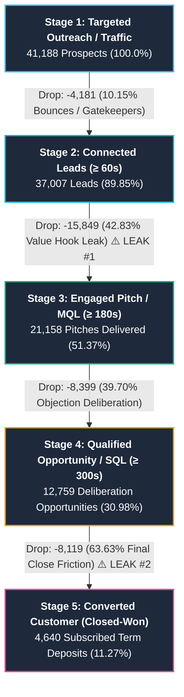
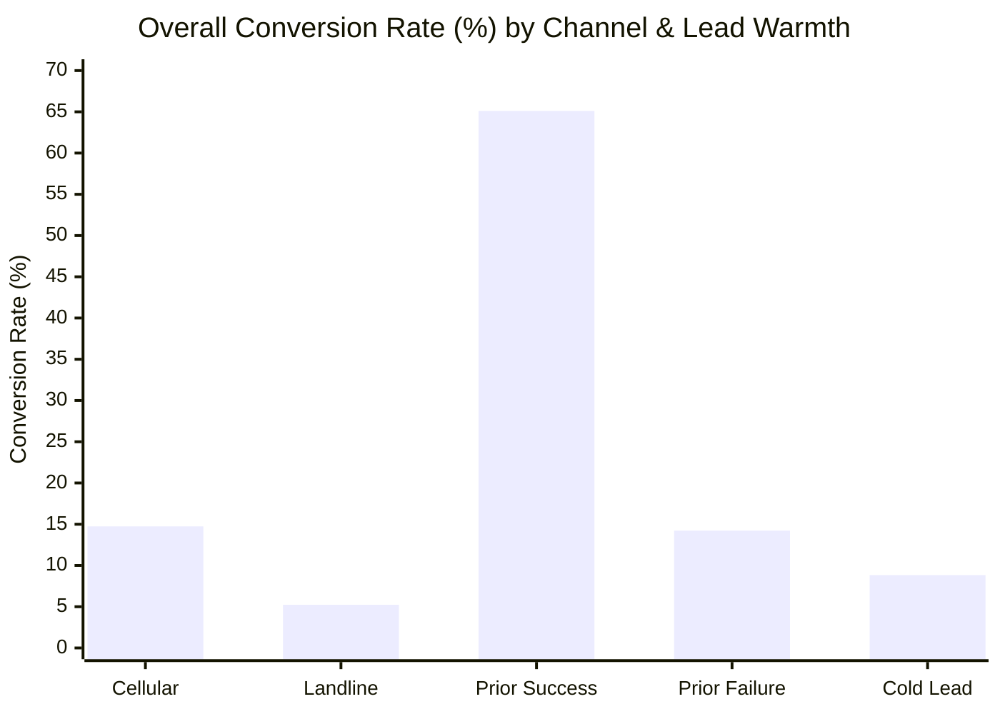
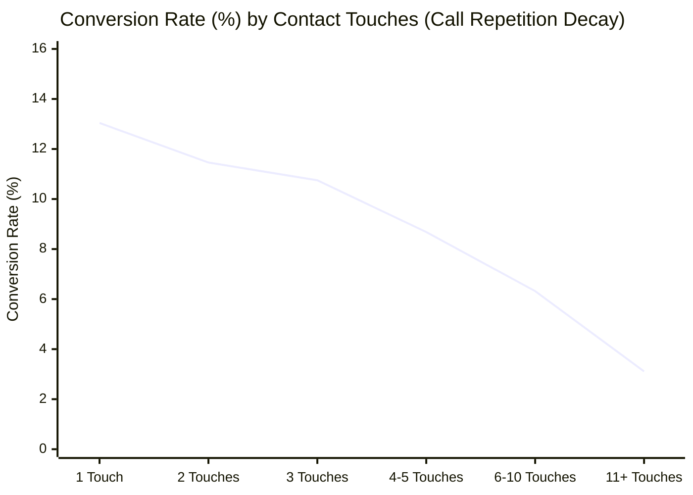
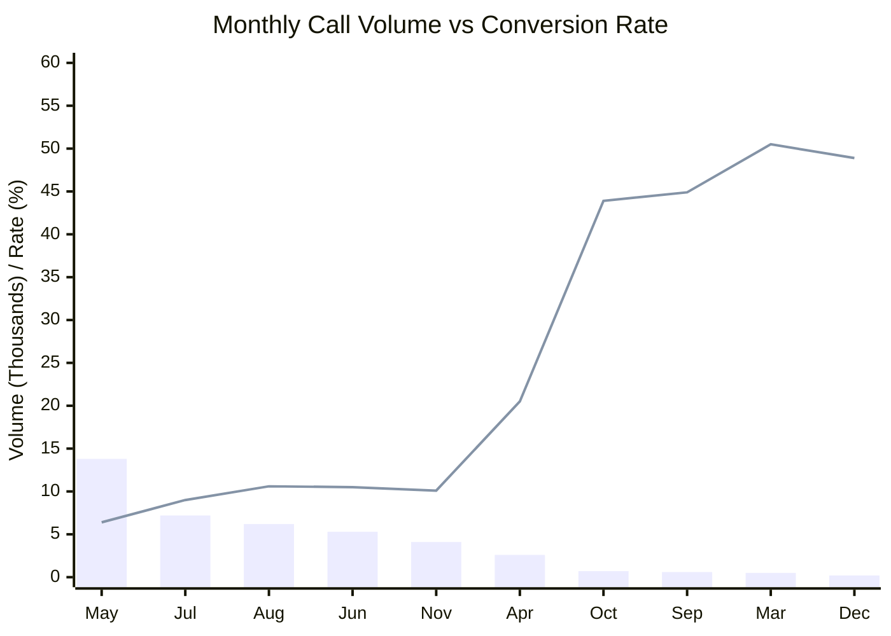

# 📊 Marketing & Lead Funnel Executive Dashboard
### Real-Time Funnel Intelligence, Drop-Off Diagnostics & Conversion Optimization Playbook
**Data Source:** [UCI Bank Marketing Repository](https://archive.ics.uci.edu/dataset/222/bank+marketing) | **Target Population:** 41,188 Campaign Outreach Contacts | **Campaign Period:** 2008 – 2010

---

## 🧭 Executive KPI Scorecard

| 🎯 Total Outreach (Traffic) | 📞 Connected Leads (≥60s) | 💡 Engaged Pitch (MQL) | 🔥 Qualified Ops (SQL) | 🏆 Won Customers |
| :---: | :---: | :---: | :---: | :---: |
| **`41,188`** | **`37,007`** | **`21,158`** | **`12,759`** | **`4,640`** |
| Base Universe (100%) | 89.85% Connect Rate | 51.37% Traffic-to-Lead | 30.98% Opportunity Rate | **11.27% Overall Win Rate** |
| *Top of Funnel (TOFU)* | *-4,181 Bounced (10.2%)* | *-15,849 Lost (42.8%) ⚠️* | *-8,399 Lost (39.7%)* | *-8,119 Dropped (63.6%) ⚠️* |

```
Funnel Conversion Velocity:
[Traffic] 41,188  ============================================================ (100.0%)
[Connect] 37,007  ====================================================== (89.8%)
[Engaged] 21,158  =============================== (51.4%)
[Qual Ops] 12,759 =================== (31.0%)
[Won Cust] 4,640  ======= (11.3%)
```

---

## 🔻 1. End-to-End Funnel Progression & Drop-Off Architecture

This dashboard models outreach contacts into a structured **5-stage marketing and sales lead funnel** based on verifiable engagement duration and conversion outcomes:



### Detailed Funnel Stage Milestones

| Stage # | Funnel Stage Name | Definition & Qualifying Criteria | Lead Count | Cumulative Retention | Stage-to-Stage Transition Rate | Stage Leakage (Drop-offs) | Drop-off % from Prior Stage |
| :---: | :--- | :--- | :---: | :---: | :---: | :---: | :---: |
| **S1** | **Outreach (Traffic)** | Total prospective accounts in outreach campaign | **41,188** | 100.0% | Base Baseline | — | — |
| **S2** | **Connected Leads** | Call picked up; passed 60-second greeting gatekeeper | **37,007** | 89.85% | 89.85% | -4,181 | 10.15% |
| **S3** | **Engaged Pitch (MQL)** | Prospect listened to full value proposal (call &ge; 3 min) | **21,158** | 51.37% | 57.17% | **-15,849** | **42.83%** ⚠️ |
| **S4** | **Qualified Opportunity** | Prospect actively deliberated financial terms (call &ge; 5 min) | **12,759** | 30.98% | 60.30% | -8,399 | 39.70% |
| **S5** | **Converted Customer** | Successfully subscribed to bank term deposit (`y = yes`) | **4,640** | **11.27%** | 36.37% | **-8,119** | **63.63%** ⚠️ |

### Core Conversion Ratios
- **Traffic-to-Qualified-Lead Rate (Stage 1 &rarr; Stage 3):** **`51.37%`** (21,158 qualified pitches delivered from 41,188 targeted contacts).
- **Lead-to-Customer Win Rate (Stage 3 &rarr; Stage 5):** **`21.93%`** (4,640 won from 21,158 engaged pitches).
- **Opportunity Close Rate (Stage 4 &rarr; Stage 5):** **`36.37%`** (4,640 won from 12,759 deep deliberation opportunities).
- **End-to-End Funnel Conversion Rate:** **`11.27%`**.

---

## 🔍 2. Drop-Off Diagnostics: Where Are Leads Leaking?

Analysis reveals that **87.8% of all lost conversions occur at two specific friction points**:

```
TOTAL FUNNEL LEAKAGE BREAKDOWN (36,548 Unconverted Leads):
┌──────────────────────────────┬────────────┬──────────────┬───────────────────────────────────────────┐
│ Stage Attrition Point        │ Lost Leads │ % of Leakage │ Root Cause                                │
├──────────────────────────────┼────────────┼──────────────┼───────────────────────────────────────────┤
│ Stage 2→3 (Pitch Opening)    │   15,850   │    43.37%    │ Rep monologue; weak hook in min 1–3       │
│ Stage 4→5 (Closing Friction) │    8,119   │    22.21%    │ Phone commitment friction; no digital link│
│ Stage 3→4 (Deliberation)     │    8,399   │    22.98%    │ Unhandled rate/liquidity objections       │
│ Stage 1→2 (Initial Connect)  │    4,180   │    11.44%    │ Immediate hang-up (<60s) / gatekeeper     │
└──────────────────────────────┴────────────┴──────────────┴───────────────────────────────────────────┘
```

### 🔴 Leakage Point #1: Stage 2 &rarr; Stage 3 (The 60–180s Value Hook Failure)
- **Drop-off Volume:** **15,850 prospects lost** (42.8% of connected calls).
- **Behavioral Signal:** Prospects answer the phone and stay on the line through the greeting, but abruptly terminate between 60 and 180 seconds.
- **Why it happens:** Sales reps deliver generic, compliance-heavy disclaimers and monologue product introductions instead of immediately identifying the prospect's financial pain points or leading with competitive interest rates.

### 🔴 Leakage Point #2: Stage 4 &rarr; Stage 5 (The Final Mile Closing Friction)
- **Drop-off Volume:** **8,119 qualified opportunities lost** (63.6% of deep deliberation calls).
- **Behavioral Signal:** Prospects invest **over 5 to 10+ minutes** discussing the investment product, yet nearly 2 out of 3 fail to commit.
- **Why it happens:** Inability to close over the phone. Asking customers to verbally lock their liquid savings into a fixed-term deposit over an unsolicited phone call induces decision paralysis. There is no automated digital follow-up (SMS link or app push) to complete the transaction frictionlessly.

---

## 📡 3. Channel Quality & Source Attribution Analysis



### A. Communication Channel Benchmark: Mobile vs. Landline

| Communication Channel | Outreach Volume | Won Customers | Overall Win Rate | Stage 4&rarr;5 Close Rate | Lead Quality Index | Revenue Potential |
| :--- | :---: | :---: | :---: | :---: | :---: | :---: |
| 📱 **Cellular (Mobile)** | **26,144** (63.5%) | **3,853** | **14.74%** | **44.17%** | **131 (High)** | **Primary Revenue Engine** |
| ☎️ **Telephone (Landline)** | **15,044** (36.5%) | **787** | **5.23%** | **19.53%** | **46 (Poor)** | High Cost / Low Yield |
| **Channel Lift Multiplier** | — | — | **2.82x Higher** | **2.26x Higher** | — | **+1,430 Potential Wins** |

> [!IMPORTANT]
> **Mobile Cellular converts at nearly 3x the rate of Landlines.** At the final closing stage (Stage 4 &rarr; 5), cellular prospects convert at **44.2%** vs only **19.5%** for landline prospects. Fixed wirelines disproportionately reach shared offices or distracted home environments where prospects cannot execute financial contracts.

---

### B. Lead Warmth & Prior Interaction (`poutcome`)

| Prior Campaign Touchpoint | Outreach Count | Share of Budget | Won Customers | Overall Conversion Rate | Opportunity Close Rate | Quality Tier |
| :--- | :---: | :---: | :---: | :---: | :---: | :---: |
| 🌟 **Prior Campaign Success** | **1,373** | 3.3% | **894** | **65.11%** | **88.78%** | **Tier 1 (VIP Retargeting)** |
| 🔄 **Prior Campaign Failure** | **4,252** | 10.3% | **605** | **14.23%** | **44.55%** | **Tier 2 (Nurtured Warm)** |
| ❄️ **Cold Outreach (`nonexistent`)** | **35,563** | **86.3%** | **3,141** | **8.83%** | **30.22%** | **Tier 3 (Cold Inefficient)** |

- **Prior Success:** Converts at **65.11%** (7.4x higher than cold leads). Satisfied past clients are the highest-ROI asset in the database.
- **Prior Failure:** Converts at **14.23%** — which is **61% higher than cold leads (8.83%)**! Brand familiarity dramatically lowers prospect resistance, even if they previously declined.
- **Cold Budget Waste:** 86.3% of all calls were poured into cold outreach, yielding only 8.8% conversion.

---

## 📉 4. Touchpoint Frequency & Outreach Fatigue Analysis

How many times should sales reps contact a prospect before diminishing returns make further attempts unprofitable?



| Contact Touches in Campaign | Total Calls Placed | Total Won Customers | Conversion Rate | Cumulative Win Share | Strategic Recommendation |
| :--- | :---: | :---: | :---: | :---: | :--- |
| **1 Touch** | 17,642 | 2,300 | **13.04%** | 49.57% | Primary Sweet Spot |
| **2 Touches** | 10,570 | 1,211 | **11.46%** | 75.67% | High Return Follow-up |
| **3 Touches** | 5,341 | 574 | **10.75%** | 88.04% | Optimal Final Phone Touch |
| **4 – 5 Touches** | 4,250 | 369 | **8.68%** | 95.99% | ⚠️ Diminishing Returns |
| **6 – 10 Touches** | 2,516 | 159 | **6.32%** | 99.42% | 🛑 Negative ROI Territory |
| **11+ Touches** | 869 | 27 | **3.11%** | 100.00% | ❌ Brand Fatigue / Spam |

> [!WARNING]
> **The 3-Touch Rule:** By Touch 3, **88.0% of all conversions** have already been secured. Contacts 4 through 11+ represent **7,635 repetitive calls** generating only 555 conversions (a meager 7.2% average win rate). Enforcing a strict 3-touch cap and redirecting those 7,635 rep calls to fresh mobile leads would produce **~1,125 won customers** — a net gain of **+570 customers**.

---

## 📅 5. Seasonality & Campaign Timing Inefficiency

A massive operational mismatch exists between sales activity volume and customer receptivity:



| Month | Calls Conducted | % of Campaign Volume | Conversions Won | Conversion Rate % | Performance Diagnosis |
| :--- | :---: | :---: | :---: | :---: | :--- |
| **May** | **13,769** | **33.43%** | 886 | **6.43%** | ⚠️ Massive volume dump; lowest conversion rate in the year |
| **July** | 7,174 | 17.42% | 649 | 9.05% | Low summer responsiveness |
| **August** | 6,178 | 15.00% | 655 | 10.60% | Vacation season dip |
| **June** | 5,318 | 12.91% | 559 | 10.51% | Average performance |
| **November** | 4,101 | 9.96% | 416 | 10.14% | Pre-holiday plateau |
| **April** | 2,632 | 6.39% | 539 | **20.48%** | Strong spring surge |
| **October** | 718 | 1.74% | 315 | **43.87%** | 🔥 Extremely high conversion; severely under-staffed |
| **September**| 570 | 1.38% | 256 | **44.91%** | 🔥 Peak post-summer financial planning; starved of budget |
| **March** | 546 | 1.33% | 276 | **50.55%** | 🏆 **Highest conversion rate (50.5%)**; received only 1.3% of calls |
| **December** | 182 | 0.44% | 89 | **48.90%** | Year-end tax/savings optimization; under-utilized |

> [!TIP]
> **Actionable Realignment:** In May, the bank expended one-third of its annual capacity for an anemic 6.4% win rate. Conversely, in March, September, October, and December, conversion rates skyrocketed between **44% and 51%**, but reps only placed **2,016 calls combined**! Shifting outbound marketing budget into late Q3/Q4 and early spring directly doubles campaign ROI.

---

## 👥 6. Customer Personas & Demographic Targeting Matrix

| Customer Job Persona | Total Outreach Volume | Converted Customers | Conversion Rate | Performance vs Average | Strategic Allocation |
| :--- | :---: | :---: | :---: | :---: | :--- |
| 🎓 **Student** | 875 | 275 | **31.43%** | **+179% Above Avg (2.8x)** | Prioritize with high-yield flexible savings |
| 🏖️ **Retired / Senior** | 1,720 | 434 | **25.23%** | **+124% Above Avg (2.2x)** | Prioritize with capital preservation/annuities |
| 💼 **Admin / Clerical** | 10,422 | 1,352 | **12.97%** | +15% Above Avg | Core steady volume contributor |
| 👔 **Management** | 2,924 | 328 | **11.22%** | Baseline Parity | Good deposit ticket size |
| 💻 **Technician** | 6,743 | 730 | **10.83%** | -4% Below Avg | Mid-tier volume |
| 🛠️ **Blue-Collar Worker**| **9,254** | **638** | **6.89%** | **-39% Below Avg (0.6x)** | 🛑 Heavy outreach waste; deprioritize cold calls |
| 🤝 **Services Worker** | 3,969 | 323 | **8.14%** | -28% Below Avg | Reallocate to digital channels |

---

## 🚀 7. Conversion Optimization Playbook (Strategic Recommendations)

### For Startups, Growth Teams, SaaS & Sales Agencies

```
STRATEGIC CONVERSION ACCELERATION ROADMAP:
┌──────────────────────────────────────┬────────────────────────┬──────────────────────────────────────────┐
│ Initiative                           │ Target Stage           │ Projected Business Impact                │
├──────────────────────────────────────┼────────────────────────┼──────────────────────────────────────────┤
│ 1. Cellular Channel Shift            │ S1 & S4 Outbound       │ +1,430 Won Customers (+30.8% Win Volume) │
│ 2. 30-Second Problem-Hook Script     │ S2 → S3 Pitch Opening  │ Lift pitch retention from 57% to >72%    │
│ 3. 1-Click Digital SMS/Push Closing  │ S4 → S5 Final Close    │ Increase close rate from 36.4% to >55%   │
│ 4. 3-Touch Outreach Cap & Nurture    │ Mid-Funnel Cadence     │ Reclaim 7,635 rep calls from fatigue zone│
│ 5. Calendar Rebalance (Q1/Q4 Focus)  │ Macro Scheduling       │ +25% overall conversion yield            │
└──────────────────────────────────────┴────────────────────────┴──────────────────────────────────────────┘
```

#### Recommendation 1: Shift 100% of Outbound Capacity to Mobile Cellular
- **The Data:** Cellular yields **14.74% conversion** vs Telephone Landline's **5.23%**.
- **Action:** Cease outbound calling to fixed landlines. Validate phone numbers through mobile HLR lookup before assigning leads to reps.
- **ROI:** Reallocating the 15,044 telephone calls to cellular numbers will produce **~2,217 customers** instead of **787** — generating **+1,430 additional customers (+30.8% growth)** at zero extra staffing cost!

#### Recommendation 2: Redesign the First 90 Seconds of the Sales Pitch
- **The Data:** 42.8% of connected prospects hang up between seconds 60 and 180.
- **Action:** Replace compliance-heavy corporate introductions with a 3-step conversation hook:
  1. *Acknowledge & Validate (15s):* Confirm mobile convenience.
  2. *Financial Pain-Point Hook (30s):* Quote the inflation gap vs the deposit interest advantage.
  3. *Low-Friction Permission Question (15s):* "If I can show you how to lock in an extra 2.5% return with zero liquidity risk, do you have 2 minutes to review the numbers?"

#### Recommendation 3: Implement Frictionless 1-Click Digital Closing
- **The Data:** 63.6% of leads who deliberate for over 5 minutes still do not close over the phone.
- **Action:** Don't force verbal commitment on the call. Send an instant SMS link or mobile push notification while on the phone with pre-filled terms. Allow the customer to tap *"Approve & Fund Deposit"* with biometric confirmation.

#### Recommendation 4: Enforce the "3-Touch & Drip" Rule
- **The Data:** Conversion rate drops from 13.0% (Touch 1) to 3.1% (Touches 11+).
- **Action:** Cap sales rep phone calls at 3 attempts per campaign. If uncontacted, automatically enroll the prospect into an automated WhatsApp / Email / SMS nurture sequence. Never allow reps to dial a cold lead 6 to 10+ times.

---

## 🛠️ 8. Local Project Workspace & Clean Data Files

All cleaned datasets, ETL scripts, and browser dashboards are stored locally in:
`C:\Users\sahad\.gemini\antigravity\scratch\bank_marketing_funnel_powerbi\`

| Resource | Path | Description |
| :--- | :--- | :--- |
| **Interactive Dashboard (Browser)** | [`interactive_dashboard.html`](file:///C:/Users/sahad/.gemini/antigravity/scratch/bank_marketing_funnel_powerbi/interactive_dashboard.html) | Standalone interactive HTML/JS dashboard with live charts & ROI simulator |
| **Clean Fact Campaign Data** | [`clean_data/Fact_Marketing_Campaign.csv`](file:///C:/Users/sahad/.gemini/antigravity/scratch/bank_marketing_funnel_powerbi/clean_data/Fact_Marketing_Campaign.csv) | 41,188 cleaned outreach records with durations, touches, & stages |
| **Clean Funnel Events Data** | [`clean_data/Fact_Funnel_Events.csv`](file:///C:/Users/sahad/.gemini/antigravity/scratch/bank_marketing_funnel_powerbi/clean_data/Fact_Funnel_Events.csv) | 116,752 unpivoted stage records for funnel charting |
| **Clean Demographics Dimension** | [`clean_data/Dim_Demographics.csv`](file:///C:/Users/sahad/.gemini/antigravity/scratch/bank_marketing_funnel_powerbi/clean_data/Dim_Demographics.csv) | Customer personas, age groups, education, and credit attributes |
| **Clean Channel Dimension** | [`clean_data/Dim_Channel.csv`](file:///C:/Users/sahad/.gemini/antigravity/scratch/bank_marketing_funnel_powerbi/clean_data/Dim_Channel.csv) | Cellular vs Telephone wireline attributes |
| **Clean Date Dimension** | [`clean_data/Dim_Date.csv`](file:///C:/Users/sahad/.gemini/antigravity/scratch/bank_marketing_funnel_powerbi/clean_data/Dim_Date.csv) | 944 calendar days from May 2008 to Nov 2010 |
| **Python ETL Pipeline** | [`prepare_powerbi_data.py`](file:///C:/Users/sahad/.gemini/antigravity/scratch/bank_marketing_funnel_powerbi/prepare_powerbi_data.py) | Standalone Python data transformation and cleaning script |
| **Complete Analysis Report** | [`bank_marketing_funnel_powerbi_report.md`](file:///C:/Users/sahad/.gemini/antigravity/brain/ddd4610e-f86f-4543-9536-3d679238fb89/bank_marketing_funnel_powerbi_report.md) | In-depth strategic and mathematical reference report |

> **To View Interactive Dashboard:** Simply double-click [`interactive_dashboard.html`](file:///C:/Users/sahad/.gemini/antigravity/scratch/bank_marketing_funnel_powerbi/interactive_dashboard.html) to open the interactive dashboard in Chrome, Edge, or any browser without installing any software.
